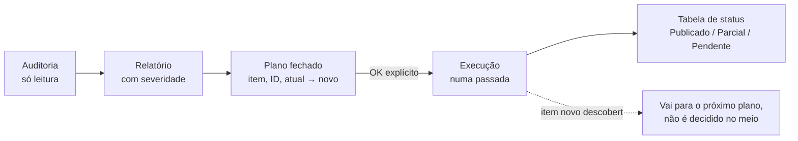

# Claude Skills para operação de mídia e comunicação

Duas [Skills do Claude](https://docs.claude.com/en/docs/agents-and-tools/agent-skills/overview) que eu escrevi e uso em produção para transformar o Claude num operador de mídia paga e de comunicação em grupos, trabalhando no navegador real com as sessões já logadas (extensão Claude in Chrome).

**O que demonstra:** desenho de agente com fases e travas de segurança (só leitura → plano → aprovação → execução), conhecimento operacional de Google Ads, GTM e Meta transformado em procedimento reproduzível, e uma ferramenta pequena e original (`decode_label.py`) que acha um erro de rastreamento que nenhuma interface mostra.

| Skill | O que faz | Trava principal |
|---|---|---|
| [`auditoria-midia-chrome`](skills/auditoria-midia-chrome/SKILL.md) | Audita e otimiza Google Ads, GTM, GA4 e Meta Ads de clientes pelo Chrome: mapa de contas, conversões, tags, landing, termos de pesquisa. Publica o relatório e aplica as mudanças aprovadas. | Auditoria sempre só de leitura; mudança só com plano fechado e valores exatos aprovados. |
| [`regua-whatsapp-live`](skills/regua-whatsapp-live/SKILL.md) | Do link do YouTube até a régua de 6 mensagens agendadas nos grupos de WhatsApp da comunidade, passando pelo teste. | Envio de teste só no grupo de teste; agendamento em massa só com "pode agendar" explícito. |

## Por que skills, e não um prompt longo

- **Carregamento sob demanda.** O Claude lê só a descrição de cada skill até ela ser necessária; as referências por plataforma (`references/google-ads.md`, `gtm.md`, `meta-ads.md`) entram quando a tarefa chega lá. Contexto curto, menos erro.
- **Memória operacional versionada.** Cada armadilha que já custou tempo vira uma linha do procedimento: tabela virtualizada do Google Ads, saída do `javascript_tool` truncando em ~1.000 caracteres, checkbox escondido que não marca pela ref, primeira digitação que se perde logo após o carregamento.
- **Estado entre sessões.** A skill de mídia mantém um registro por cliente (`references/contas.md`, fora do git; modelo em `contas.exemplo.md`) com IDs, mudanças aplicadas e checkpoints, para a próxima sessão começar dali.

## Decisões de desenho



- **Plano fechado antes, execução de uma vez.** Toda a análise termina antes da proposta (ler a landing, o simulador de orçamento, a tag), para que nada seja decidido no meio da execução. Depois do OK, o agente não volta para perguntar: economiza contexto e evita aprovação por cansaço.
- **Mudança pontual e reversível.** No GTM, cria acionador novo em vez de editar um compartilhado com tags de outras contas; pausa em vez de apagar; publica **uma** versão com nome em Conventional Commits.
- **Respeito à política de permissões.** Se o classificador do agente bloquear uma ação (ex.: criar variável de dados do usuário, que envolve PII), a skill não tenta contornar: cancela sem salvar e entrega o caminho de cliques para o humano.
- **Disparo em massa é irreversível.** Por isso a régua para entre o teste e o agendamento, e confere por JS que nenhum grupo de outro produto ficou marcado.

## `decode_label.py`: o erro que a interface não mostra

O rótulo de conversão do Google Ads (`AW-XXXX/rotulo`) é um base64url de um protobuf que carrega o **tipo de conversão** e a **conta de origem**. Quando alguém copia o rótulo de uma conta e o ID da tag de outra, a tag dispara, o GTM mostra "disparou" e a conversão **nunca** registra. Decodificar o rótulo revela a divergência em um comando:

```bash
python3 skills/auditoria-midia-chrome/scripts/decode_label.py XwY3CNKF2MwEEKzL2ucp AW-55555555555
# ctId=1234567890  conta_do_rotulo=AW-11223344556
# DIVERGE: tag envia para AW-55555555555
```

(Exemplo fictício: o rótulo foi gerado pela função `encode` do próprio script.)

## Como usar

```bash
# Claude Code: copie as skills para a pasta do usuário
cp -R skills/* ~/.claude/skills/

# testes do decodificador
python3 -m venv .venv && .venv/bin/pip install pytest && .venv/bin/pytest -q
```

No claude.ai, compacte cada pasta de `skills/` em zip e envie em Configurações → Capacidades → Skills.

---

<sub>Skills extraídas do meu uso real e generalizadas: sem nomes de clientes, contas, IDs ou dados de terceiros. O exemplo de régua usa uma comunidade e uma apresentadora fictícias.</sub>
